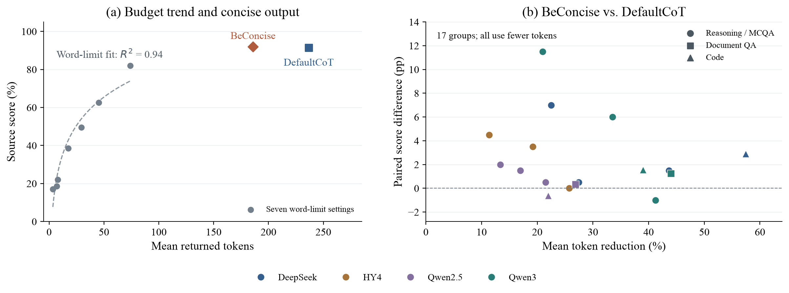
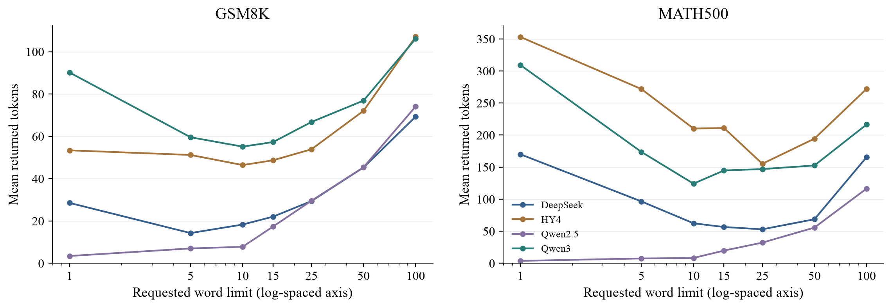
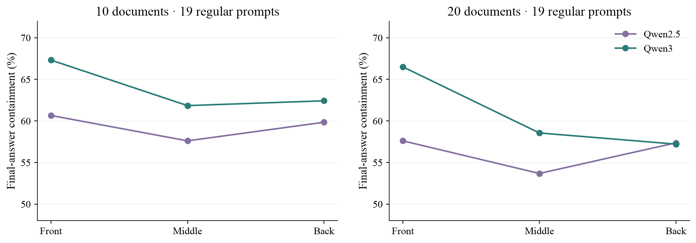
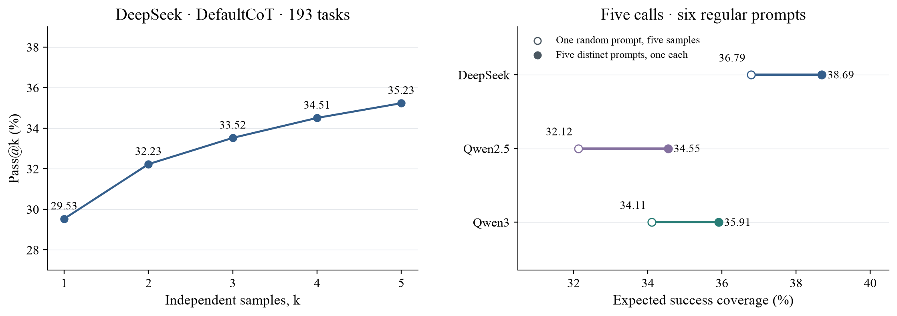
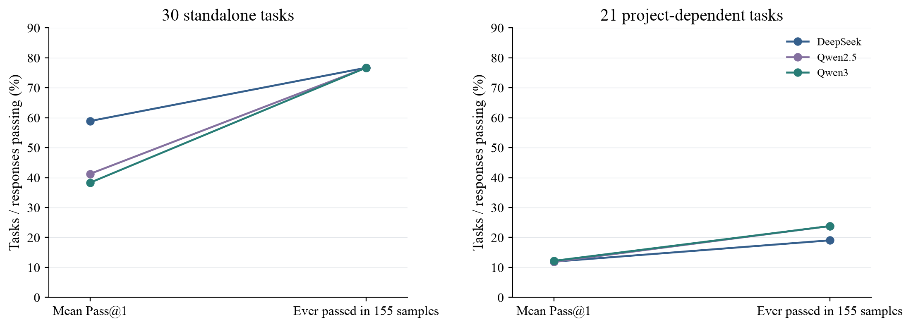

# 输出篇幅、证据位置与成功覆盖：三类大模型任务的实验故事

版本：2026-10-26。课堂讲述稿与证据提纲；网页保持原状。

## 整体主线

我们从一个直观预期出发：给模型更多表达空间、更多上下文、更多生成机会，应该能让任务完成得更好。三组实验让这个预期变得具体：有些输出可以压缩，有些极端约束会引发反弹；相同证据放在不同位置，模型利用效果不同；更高的平均正确率、更多重复生成，也未必带来相同比例的成功覆盖。

**最终需要追踪的是：模型是否提取并交付了有效答案，以及这种成功有多稳定。**

三组实验分别研究：

| 方向 | 任务 | 主要变化 | 结果指标 |
|---|---|---|---|
| 推理与选择题 reasoning | GSM8K、MATH500、MMLU-Pro，各 200 题 | 4 模型、31 提示 | 源规则评分、返回 Token、截断与提取状态 |
| 文档问答 document_qa | 同一批 200 道 NQ-Open 问题 | 2 模型、提示、10/20 篇文档、证据位置 | 最终答案包含率等四种口径 |
| 代码生成 ZYT | 193 道共同可评 Python 函数任务 | 3 模型、31 提示、每条件 5 次独立采样 | 测试通过、Pass@k、错误类型 |

下面用六个故事组织发现。每个故事依次说明实验、预期、实际案例、总体证据和解释。问题中文表述为译述；标为“原文”的模型输出保持保存文本，删节处明确标注。完整输出见[案例原文](案例原文.md)。

---

## 故事一：一步步回答可以很简洁，输出长度与有效信息量并不同步

### 1. 我们改变了什么？

31 种提示包含直接回答、默认分步、简洁分步、分点、词/字母/Token/步骤限制、中文模板和格式压力策略。本故事首先比较只有一句要求差异的两个提示：

| 提示 | 原文 | 含义 |
|---|---|---|
| DefaultCoT | `Think step by step before answering.` | 回答前逐步思考 |
| BeConcise | `Think step by step before answering, but be concise.` | 仍逐步思考，增加“保持简洁”要求 |

两组使用相同模型、问题和生成设置。代码任务中，分别要求在代码前写逐步解释或简洁解释，完整 Python 函数均保留。

### 2. 原始预期：压缩输出会不会牺牲解题信息？

先看长度档位实验。在 Qwen2.5 的 GSM8K 上，WordLimit 的七个档位给出了清楚的预算趋势：

| 名义词数 | 1 | 5 | 10 | 15 | 25 | 50 | 100 |
|---|---:|---:|---:|---:|---:|---:|---:|
| 平均返回 Token | 3.4 | 7.0 | 7.8 | 17.4 | 29.6 | 45.4 | 74.1 |
| 源评分通过率 | 17.0% | 18.5% | 22.0% | 38.5% | 49.5% | 62.5% | 82.0% |

在这组点上，`SR = a + b·ln(平均 Token)` 的描述性拟合 R² 为 **0.94**；同模型的 MATH500、MMLU-Pro 分别为 **0.88、0.71**。这构成了一个具体预期：当输出空间过小时，放宽限制可以恢复表现。

接下来问：**默认逐步回答中的所有文字，都同样有助于解题吗？**

### 3. 真实对照 A：同样正确，少掉的是重复铺陈

问题译述：屠夫每小时卖 15 kg 肉，每天工作 10 小时。卖完 750 kg 肉需要几天？

模型：DeepSeek。标准答案：5。记录：`Z006587` / `Z006787`。

DefaultCoT 原回答分成“每日销量”“牛肉总量”“所需天数”“结论”四段，逐条复述题目，使用 **163 Token**。下面保留其中的计算原句：

> So, daily sales = \( 15 \times 10 = 150 \) kg per day.
>
> Days needed = \( 750 \div 150 = 5 \) days.
>
> Answer: 5

BeConcise 的完整回答为 **40 Token**：

~~~text
Prince sells 15 kg/hour × 10 hours/day = 150 kg/day.
The bull weighs 750 kg.
750 ÷ 150 = 5 days.

Answer: 5
~~~

两次评分均为 1。必要计算完整保留，重复解释和段落包装被压缩。

### 4. 真实对照 B：更紧凑的过程，让最终答案得以完成

问题：把二进制 `10101001110₂` 转成八进制。模型：DeepSeek。记录：`Z012672` / `Z012872`。

DefaultCoT 在分组时反复检查，后来已经写出 `2516₈`，又开始用十进制验算，最终在 **800 Token** 被截断，源评分为 0。

BeConcise 用 **89 Token** 完成同一道题：

~~~text
First, group the binary digits into sets of three from right to left:

10101001110 → 10 101 001 110
Pad the leftmost group: 010 101 001 110

Convert each group:
010₂ = 2
101₂ = 5
001₂ = 1
110₂ = 6

So in octal: 2516₈

Answer: 2516
~~~

这个案例把“内容中出现答案”与“完成最终交付”区分开来。

### 5. 从例子回到总体

三个方向共 **17 个分组，BeConcise 的平均输出全部缩短；15 组评分点估计持平或提高**。两组下降分别为 Qwen3/GSM8K 的 −1.0 pp、Qwen2.5/代码的 −0.62 pp。

| 代表条件 | DefaultCoT → BeConcise：平均 Token | 表现 |
|---|---:|---:|
| DeepSeek / GSM8K | 166.8 → 94.0 | 97.5% → 99.0% |
| Qwen2.5 / GSM8K | 236.7 → 185.8 | 91.5% → 92.0% |
| Qwen3 / 文档问答 | 146.4 → 82.0 | 最终包含 64.92% → 66.17% |
| DeepSeek / 代码 | 662.5 → 281.8 | Pass@1 29.53% → 32.44% |



图左先展示 Qwen2.5/GSM8K 七个实测词数档位，虚线只拟合这七点的观测范围；随后加入 DefaultCoT 与 BeConcise 的同题对照。图右每点是一个模型×任务分组，两轴分别表示输出减少比例和该任务自身的评分差。颜色表示模型，形状表示任务方向；各任务分数分别计算。

### 6. 中文模板进一步揭示了压缩与完成度的联系

ChineseCoT 原文是 `Respond in Chinese.`。相对 DefaultCoT，**12 个模型×任务组合的平均输出全部缩短，降幅 4.4%–48.7%**。

在 MATH500 上：

| 模型 | Token 减少 | 得分变化 | 截断率变化 |
|---|---:|---:|---:|
| DeepSeek | 4.4% | 76.0% → 75.0% | 23.5% → 24.5% |
| HY4 | 19.5% | 68.5% → 74.0% | 30.5% → 23.0% |
| Qwen2.5 | 33.3% | 68.0% → 70.5% | 22.0% → 2.5% |
| Qwen3 | 19.5% | 58.0% → 69.5% | 31.5% → 23.5% |

实际例子：七袋等量金币，加上新发现的 53 枚后能均分八袋，求原来最少的金币数。Qwen3 的 DefaultCoT 在 **800 Token** 截断；中文模板用 **552 Token** 完成同余计算并给出 `203`。原文和记录 `Z049851` / `Z054851` 已收录。

逐题检查还有一条共同证据：MATH500 的“4 模型×中文/简洁两模板”八组中，七组净升分；八组各自得分改善的题目里，**57%–100% 在默认 CoT 下被截断**。例如 DeepSeek/BeConcise 新增命中 15 题，这 15 题的基线全部截断。

### 本章结论

**默认逐步回答存在较大的表达压缩空间。简洁提示跨任务减少输出；中文模板在 MATH500 上让多数模型同时省 Token、提高得分。长回答完成度的改善，是这组收益的重要解释线索。**

讲述过渡：既然紧凑表达有效，那么把限制继续收紧，会不会更省？

---

## 故事二：极端限长引发输出反弹，模型会为满足格式花掉大量篇幅

### 1. 实验与预期

WordLimit 从 100、50、25、15、10、5 收紧到 1；CharLimit 使用 500、100、50、10 四档。CharLimit 的原提示实际写作 `Only use N letters for your answer.`，因此本章称“字母限制”。

直观预期是：要求更短，实际输出也应更短。七个词数档位让我们可以检查整个变化过程。

### 2. 真实案例：答案已算出，却被“十个字母”困住

问题译述：196 有多少个正因数？标准答案为 9。模型：DeepSeek。记录：`Z015804` / `Z015404`。

100 字母条件用 **25 Token** 完整交付：

~~~text
196=2²×7², divisors=(2+1)(2+1)=9.
Answer: 9
~~~

10 字母条件先正确算出 9，随后出现以下原文：

> We need the answer in 10 letters. “Nine” is only 4 letters ...

后文继续尝试给 `NINE` 填充字母，最终在 **801 Token** 截断，源评分为 0。完整回答见案例原文。

### 3. 反弹有多普遍？

- 100 字母 → 10 字母：**9/12 组平均输出增加**，这九组 Token 差值的题目 bootstrap 区间均为正。
- 10 个词 → 1 个词：同样 **9/12 组平均输出增加**。
- 两类反弹均出现在 DeepSeek、HY4、Qwen3 的三个 benchmark 上。

| MATH500 / 模型 | 100 字母时平均 Token | 10 字母时平均 Token | 评分变化 |
|---|---:|---:|---:|
| DeepSeek | 102.0 | 520.6 | 83.5% → 38.0% |
| HY4 | 257.7 | 504.9 | 83.0% → 56.0% |
| Qwen3 | 242.8 | 330.4 | 71.0% → 73.0% |



图上所有点都是真实词数档位，横轴用对数间距同时容纳 1–100。左端反弹与中部较短输出清楚可见；连线仅连接观测。

### 本章结论

**压缩要求过强时，输出会反弹。字母案例进一步显示：模型已经算出结果，仍可能把后续篇幅用于处理格式，直到截断。**

解释层次：总体统计确认反弹；原始回答说明其中一种失败路径。它与故事一共同构成“温和简洁有效、极端限制可能失效”的完整对照。

讲述过渡：除了要求模型怎样输出，输入证据的组织会产生什么影响？

---

## 故事三：证据位置影响成功题目集合，模型提升也带有位置偏向

### 1. 实验与预期

每题提供 20 篇文档，其中一篇包含相关证据。保持同一问题、全部文档内容和干扰文档相对顺序，移动证据文档的位置。Qwen2.5 补测使用 NoCoT，在 **1、3、5、8、10、13、15、18、20** 九个位置各测同样 200 道题。

预期：证据内容相同，模型应能在各位置识别同一个答案。

### 2. 真实对照：相同资料集合，答案随位置改变

案例 `C007`，问题原文：`who has the most gold gloves at shortstop`。该题标准答案别名为 `Ozzie Smith`。

| 证据位置 | Qwen2.5 原始回答 | 最终答案包含 |
|---|---|---:|
| 第 1 位 | `Ozzie Smith FINAL ANSWER: Ozzie Smith` | 1 |
| 第 10 位 | `Omar Vizquel` | 0 |
| 第 20 位 | `Ozzie Smith FINAL ANSWER: Ozzie Smith` | 1 |

另一个反方向案例 `C001`：电影续作问题中，首位回答 `It Runs in the Family`，中位回答标准别名 `My Summer Story`。这种双向变化帮助解释总体差值为什么较小。

### 3. 九点轮廓与逐题变化要一起看

| 位置 | 1 | 3 | 5 | 8 | 10 | 13 | 15 | 18 | 20 |
|---|---:|---:|---:|---:|---:|---:|---:|---:|---:|
| 最终答案包含率 | 54.5% | 52.5% | 50.0% | 52.0% | 52.5% | 50.5% | 51.0% | 51.0% | 56.5% |

总体呈两端偏高的浅 U 形趋势。更深入的发现来自逐题对照：

- 首位与中位平均只差 **2 pp**，但 **38/200=19%** 的题目发生评分变化。
- 21 题仅首位命中，17 题仅中位命中，双向变化抵消了大部分平均差距。
- 文档位置中，**39%** 的题目至少发生一次评分变化。

**平均命中率接近，可以掩盖成功题目集合发生的明显变化。**

九点主图沿用[该批次位置图](../position-extension-qwen25/position-profile.svg)。它使用真实位置与题目 bootstrap 区间，没有插值补点。

### 4. 模型比较：Qwen3 的优势主要出现在前部

回到原始双模型配对实验，使用事先定义的 19 种常规提示，避免让极端格式压力主导位置比较。Qwen3 相对 Qwen2.5 的最终答案包含率增益为：

| 范围 | 前部 | 中部 | 尾部 |
|---|---:|---:|---:|
| 10/20 篇等权汇总 | +7.78 pp | +4.55 pp | +1.21 pp |
| 20 篇 | +8.89 pp | +4.87 pp | −0.16 pp |

**18/19 种提示**都显示前部模型增益大于尾部。汇总条件的增益差为 **6.57 pp，95% 区间 [2.60, 10.41]**；四种评分口径均保持同方向。



这张图比较原始三处位置的模型差距，与新批次九点曲线分别展示；两批结果不拼接。

### 本章结论

**证据的组织位置影响具体题目的成功稳定性。Qwen2.5 呈浅 U 形轮廓；Qwen3 相对 Qwen2.5 的提升集中在前部，尾部仍是共同薄弱区域。**

讲述过渡：如果一次回答不稳定，多生成几次能覆盖多少失败？

---

## 故事四：平均正确率、重复稳定性和最终成功覆盖，是三种不同的表现

### 1. 实验与预期

三个模型在同一代码任务、同一提示下各独立采样五次。每次都是单轮请求，互相看不到答案，也没有测试反馈。

我们先观察“同一个条件下重复生成”，再看“汇总更多提示后究竟覆盖了哪些题”。

### 2. 真实案例：同一道函数题的五次结果

案例 `T005`：给定 `argparse.ArgumentParser`，返回以空格连接的参数标志字符串。固定 DefaultCoT：

| 模型 | 五次测试结果 |
|---|---|
| DeepSeek | 通过、通过、通过、通过、通过 |
| Qwen2.5 | 失败、失败、失败、失败、失败 |
| Qwen3 | 通过、通过、失败、失败、失败 |

这道题可以用来说明三个层次：某次输出是否通过；同一条件能否稳定通过；扩展提示与采样后是否曾通过。

### 3. 重复采样增加覆盖，但大量失败持续存在

只看 DefaultCoT：

| 模型 | Pass@1 | Pass@5 | 五次全失败题目占比 |
|---|---:|---:|---:|
| DeepSeek | 29.53% | 35.23% | 64.77% |
| Qwen2.5 | 26.53% | 33.68% | 66.32% |
| Qwen3 | 26.94% | 33.16% | 66.84% |

用于这一二维比较的主图，应固定一个模型，横轴为 k=1、2、3、4、5，纵轴为 Pass@k；模型之间另作分面。五个真实采样档位完整保留。



图左为固定 DeepSeek/DefaultCoT 的五个真实档位；图右用于下一章的等调用数策略对照。

### 4. 最有意思的发现：独立函数题上，正确率差距大，最终覆盖集合相同

30 道 self_contained 独立函数任务中，每模型汇总 31 提示×5 次采样：

| 模型 | 平均 Pass@1 | 曾通过的题目 |
|---|---:|---:|
| DeepSeek | 58.88% | 23/30 |
| Qwen2.5 | 41.25% | 23/30 |
| Qwen3 | 38.30% | 23/30 |

**三个模型通过的是完全相同的 23 道题。** 这里的 155 份回答来自 31 种不同提示，每提示五次，称为“跨提示的曾成功覆盖”。

只用七种常规提示，三模型覆盖为 21、21、20 题，交集 20 题、并集 22 题，仍高度重合。

### 5. 项目依赖任务形成共同低位

21 道 project_runnable 任务中，三模型平均 Pass@1 分别为 **11.92%、11.86%、12.20%**，差距明显收敛。16 道题在三模型×31 提示×5 次采样共 **465 份回答下均未通过**。

全体 193 题中，有 **95 题全部 465 份回答未通过**。DeepSeek 全记录覆盖 92 题；合并两个 Qwen 后覆盖 98 题。

任务输入固定为函数说明、签名与包信息。依赖类别来自原始数据；“项目依赖”指实现涉及项目范围上下文，不表示本实验额外向模型提供了整个仓库。



### 本章结论

**独立函数任务上的模型差距主要体现为成功稳定性，三模型的最终成功集合高度重合；项目依赖任务则形成共同失败区域。重复生成扩大覆盖，但没有消除这批持续失败。**

讲述过渡：同样五次机会，换一种组织方式，能否获得更好的覆盖？

---

## 故事五：提示之间存在互补性，五次机会分散到不同提示能增加覆盖

### 1. 比较的是哪两种策略？

为避开极端格式和 NoCoT 提取问题，使用六种常规提示：DefaultCoT、BeConcise、BulletPoints、StepLimit(1/2/5)。

- 固定策略：均匀随机选一种提示，对它独立生成五次。
- 分散策略：均匀无放回选五种不同提示，各独立生成一次。

两者都是五次调用，每次调用的提示边际分布一致，因此期望 Token 开销也一致。我们使用每条件已有五次保存回答，计算所有提示组合的离线期望。

### 2. 用实际记录解释“互补”

仍看 `T005` 的 Qwen2.5：DefaultCoT 五次全失败，StepLimit(5) 的五次结果为“失败、通过、失败、失败、通过”。

它说明换提示能产生固定提示下未覆盖的成功；个别例子用于展示机制，整体验证对六种提示均匀计算。

### 3. 三模型同方向的结果

| 模型 | 固定一种提示×五次 | 五种提示×各一次 | 增加 |
|---|---:|---:|---:|
| DeepSeek | 36.79% | 38.69% | +1.91 pp |
| Qwen2.5 | 32.12% | 34.55% | +2.42 pp |
| Qwen3 | 34.11% | 35.91% | +1.80 pp |

三项差值的题目 bootstrap 95% 区间分别为 **[0.82, 3.18]、[1.41, 3.65]、[0.79, 3.01]**。加入 NoCoT 的七提示池也保留同方向，数据表另列。

### 本章结论

**常规提示之间存在成功互补。在提示池内，用同样五次调用分散探索提示，比随机固定一种提示重复生成，多覆盖约 1.8–2.4 个百分点。**

这一结果与前章共同解释“再生成一次”的价值：新增成功既受随机采样影响，也受提示组合影响。

讲述过渡：所有这些成功与失败，究竟是怎样被记录成分数的？

---

## 故事六：正确结果可以在交付链上丢失，评分需要追踪失败发生的环节

### 1. 最初预期

测试失败或自动评分为 0，看起来很容易被理解为模型没有解出问题。我们沿着原始输出、提取结果和测试结果逐步检查。

### 2. 数学实例：相同答案，不同包装

问题：球的体积与表面积数值相等，求半径。模型：Qwen3。正确值为 3。

| 模板 | 回答末尾原文 | 源提取结果 | 源评分 |
|---|---|---|---:|
| DefaultCoT，`Z049873` | `\text{Answer: } 3` | `} 3` | 0，未解析 |
| ChineseCoT，`Z054873` | `Answer: $3$` | `$3$` | 1 |

两条回答都推导出了 r=3。这个差值直接来自末尾格式与提取器的交互，原始“未解析”标志也印证了失败位置。

### 3. 代码实例：函数文本相同，代码块决定是否进入测试

任务 `T133`：输入为字符串且小写等于 `none` 时返回 True，否则返回 False。

Qwen3／NoCoT 的第 1 次原始输出 `Y080666`：

~~~text
def is_none_string(val: any) -> bool:
    return isinstance(val, str) and val.lower() == 'none'
~~~

它没有代码块，源结果为 `extraction_error`。

同模型／DefaultCoT 的第 1 次输出 `Y080661` 在解释后给出相同函数，并包在 Python 代码块中，源测试通过：

~~~~text
```python
def is_none_string(val: any) -> bool:
    return isinstance(val, str) and val.lower() == 'none'
```
~~~~

当前提取器仅接受代码块；Prompt 也明确要求代码块。这个实例显示的是交付协议如何影响是否进入后续测试。

### 4. 总体现象

- Qwen3／NoCoT 的 **425 条提取失败回答，全部仍含目标函数定义文本**。
- Qwen2.5 文档问答从最多 1 步到最多 5 步，最终答案包含率 **60.67%→61.08%**，首行命中率却 **45.08%→5.25%**。
- Qwen3／NoProperGrammar 的 **74.08% 首行命中率**与 **35.33% 截断率**同时存在。

### 本章结论

**内容生成、输出完成、格式提取和执行测试是不同环节。最终分数将这些环节合并，逐条追踪能够识别“没解出”“没写完”和“没被正确提取”的不同失败。**

这一章也解释了故事一：紧凑模板的一部分收益来自更好的完成情况和交付形式。课堂上先讲实测效率与机制，最后展示评价链，让整个故事闭合。

---

## 汇报结构与课程要求

建议的讲述顺序就是本稿顺序。主线浓缩为：

> **先观察输出预算与表现的关系，再通过真实对照发现表达冗余与限长反弹；随后研究证据组织与成功稳定性，最后追踪失败发生在生成、交付还是评分。**

| 课程要求 | 本稿对应内容 | 实际研究变量 |
|---|---|---|
| 低维发现 1 | 故事三：固定 Qwen2.5/NoCoT/20 篇的文档位置曲线 | 证据位置、最终命中 |
| 低维发现 2 | 故事四：固定 DeepSeek/DefaultCoT 的 Pass@1…5 | 采样次数、成功率 |
| 多维发现 1 | 故事一：跨任务简洁与中文模板 | 模型、任务、提示、Token、评分/截断 |
| 多维发现 2 | 故事三：Qwen3 增益的前中尾分布 | 模型、位置、文档数、命中；提示范围固定 |
| 其他多维 | 故事四依赖类别；故事五提示组合 | 模型、依赖类别、稳定性/覆盖；模型、策略、覆盖 |
| 异常或局限 | 故事二的限长反弹、故事六的评分交付 | 原始输出、截断、提取、源评分/测试状态 |

在页数有限的展示中，故事一保留两个实答对照和 17 组总体图；故事三保留九点曲线与逐题变化；故事四保留五次采样和覆盖集合。故事二与六各用一对案例，故事五作为补充发现。中文表格用于扩展故事一的解释，不再单独铺开 31 个提示排名。

## 方法与证据说明

1. **评分名称。** 本稿使用保存的源规则评分。文档问答明确为最终答案包含率；代码为既有统一沙箱测试结果；reasoning 同时保留提取未解析标志。“得分提高”描述当前评分链的整体结果，语义核对另行记录。示例均从保存回答抽取，中文问题为译述；完整英文原文、Token、结束状态和匿名 ID 在 `saved-examples.json` 与 `案例原文.md`。
2. **样本和区间。** reasoning 每个任务 200 题，document_qa 200 题，代码 193 道共同可评题（另 1 道环境排除题，465 条记录不计模型失败）。同题比较按题配对，探索性 95% 区间使用 5,000 次题目 bootstrap，未作多重比较校正。依赖类别对照使用不同题目组。例子展示机制，总体数量来自完整指定范围。
3. **对数拟合。** 此次核对的是 `SR=a+b ln(平均返回 Token)`，属于聚合点的描述性拟合。Qwen2.5 三任务的 WordLimit 拟合有较强正向关系；其余模型的 R² 为 0.001–0.669，部分斜率为负。它提供故事开头的具体预算趋势；全部模型的完整诊断均留在 `log-fit-diagnostics.csv`。原 reasoning 紫色阈值累计曲线属于另一种按题阈值构造，二者分别解释。
4. **精简与波动。** 17 组简洁比较中，15 组评分点估计不降；两组略降的差异区间均跨零。平均 Token 减少具有共同方向；“所有条件都无损”等效检验尚未实施。
5. **位置批次。** 文档位置曲线只用新批次的 1,800 条 Qwen2.5 回答。端点对中位的差值区间包含零，因此图形描述为浅 U 形趋势；39% 逐题变化还混合少量服务非确定性。旧、新相同提示锚点的评分一致率为 596/600。Qwen3 保持暂停；原始双模型位置增益分析和新九点曲线分别报告。
6. **采样与覆盖。** Pass@k 使用五次结果的无偏估计，保存顺序的累计成功另列。跨提示曾成功覆盖来自 31×5 份记录。故事五是提示池平均策略的离线组合期望，两策略调用数和期望 Token 相同；其对照对象为随机固定提示。代码曾成功表示通过当前测试，所有代码结果均沿用保存评分，本轮没有重新执行模型代码。

## 证据文件与复算

- [本轮深挖记录](../deeper-findings-20261026/findings.txt)：七类原始汇总与来源。
- [同题数值与恢复转变](../deeper-findings-20261026/reasoning-paired-contrasts.csv)、[数学完成情况](../deeper-findings-20261026/math-completion-recovery.csv)。
- [位置模型增益](../deeper-findings-20261026/document_qa-model-gain-by-position.csv)、[按提示增益](../deeper-findings-20261026/document_qa-model-gain-per-prompt.csv)。
- [代码依赖类别](../deeper-findings-20261026/code-dependency-levels.csv)、[覆盖重合](../deeper-findings-20261026/code-coverage-overlap.csv)、[提示互补](../deeper-findings-20261026/code-prompt-diversity.csv)。
- 本稿证据：[案例原文](案例原文.md)、[案例结构化记录](saved-examples.json)、[拟合核对](log-fit-diagnostics.csv)、[跨任务简洁点](concise-cross-task-points.csv)、[输入哈希](evidence-manifest.json)。
- 本目录五幅新图均有 SVG 和 PNG，使用 Times New Roman；原始九点位置图保留在原报告目录。

离线复算命令：

```bash
python scripts/analysis/analyze_prompt_variants.py
python scripts/analysis/build_story_evidence.py
```

本稿整合既有结论与新增分析；未改写原报告、原数据和课堂网页。
