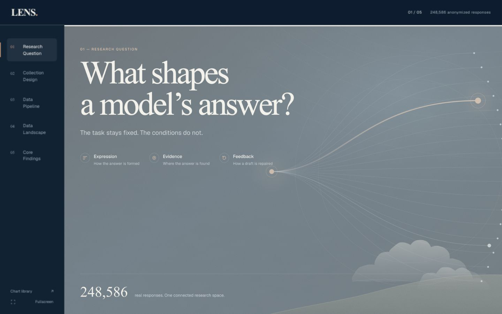
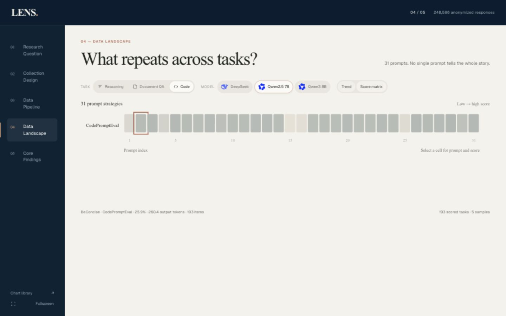

# 前端检查记录

日期：2026-10-31。交付前端已整合到原项目结构。

## 修正

- 主展示SVG模块命名为src/story-charts.js，与课程图表库src/charts.js分开；统一构建分别生成运行脚本。
- 31提示全貌接入推理372、文档问答186、代码生成93个真实条件；热图缺失数据显示不可用，避免误画成0分。
- 热图支持点击和键盘选择，显示分数、Token与题数；全貌筛选写入URL并可刷新恢复。
- 修复图纵轴包含保存的置信区间；导出菜单在工具栏换行时保持右对齐。
- 课设提交生成器适配主展示源码，匿名提交中案例区域显示数值对照。

## 验证结果

- 原始405份材料哈希校验通过；统一物理响应248586条。
- 原项目与去掉runtime/dist的独立源码副本均构建通过。
- 23个本地依赖资源可访问，JS语法、源码与运行脚本同步、三任务热图/散点数值绑定检查通过。
- 实际浏览器检查：主页、数据全貌、17组简洁对照、中文模板任务切换、九位置键盘选择及区间开关、代码模型切换及版本播放、图表库均可使用。
- 位置10显示Qwen3 61.5%、Qwen2.5 52.5%；代码热图Qwen2.5/BeConcise显示25.9%、260.4 Token、193题。
- SVG实际导出包含Times New Roman与有效viewBox；CSV实际导出3条提示记录，数值为22.0/91.5/92.0与6.465/236.735/185.845。
- 1440×900桌面与390×844窄屏检查通过，页面无横向溢出；窄屏宽图在图内滚动。
- 独立匿名课设目录的构建、资源与数据绑定检查通过。

## 复测

```bash
python3 scripts/system/check_web_snapshot.py
python3 scripts/delivery/audit_project.py
python3 scripts/delivery/build_submission.py
python3 submission/AI对话行为分析_系统/app/pipeline/scripts/system/check_web_snapshot.py --skip-build
```

浏览器截图：




