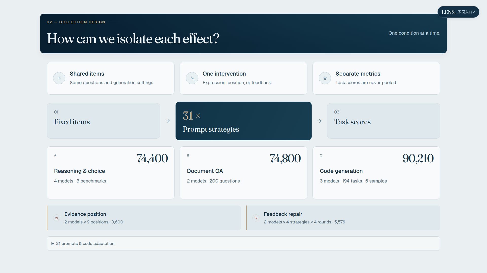
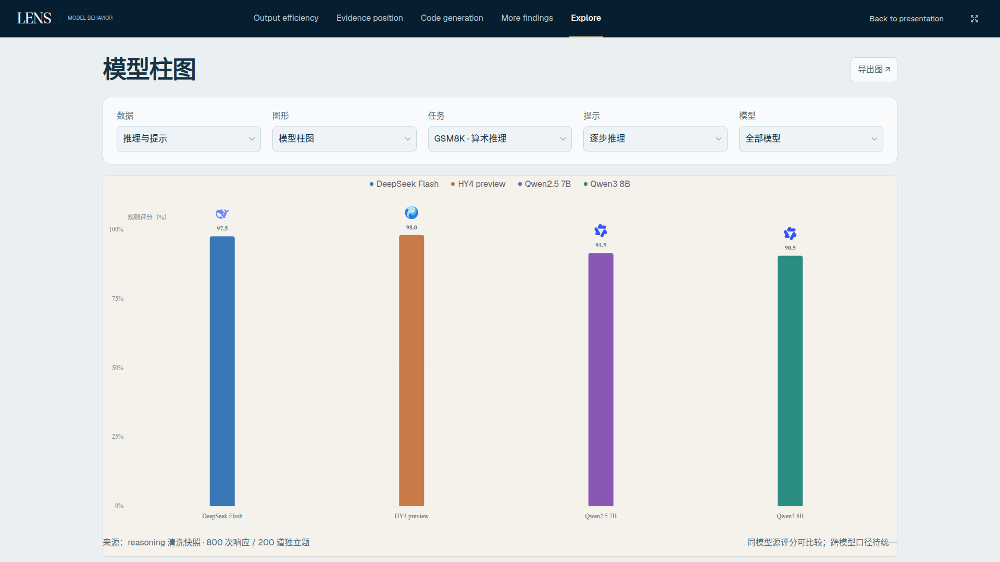

# LENS 配色统一：延续光学入口的冷色秩序

本轮以2026-11-01的d80769d为冻结基线，回应“球体进入后的研究页、图表库与开场配色不连贯”的问题。保持已有电脑布局和大字号，进行适中的颜色调整。

## 设计与实际调整

开场与入口的主色是深海蓝、冷色玻璃和少量暖金；原内容页大量使用米黄、棕灰、橙红。现在让研究标题区承接深海蓝，阅读底色使用低饱和雾蓝灰，卡片用冷白和蓝灰边框。深色区域用少量香槟金提示序号、光学细节和选中状态，浅底的小强调使用更深的金棕保证可读。

深色负责项目识别，浅色负责阅读。没有把每页变成全黑背景，也没有把科学图里的蓝、橙、紫、青等分类颜色改成统一蓝金。原科学图面仍是原来的纸白或纯白，保持测量图的对比度和颜色语义。

研究问题保留沉浸式深色，仅微调卡片边缘、序号和图标的暖色；采集设计、数据处理、全貌和核心发现使用已有标题区的深蓝背景；图表库及出版、代码、更多发现沿用深蓝导航，统一卡片、控件、说明和详情窗口。标题区变化由CSS背景完成，不增加导航，不改变原有内容位置。

## 真实设计参考与采用边界

实际使用内置`image_gen.imagegen`，以当前入口、研究问题、采集设计及图表库1920截图作为参考，生成了一张真实配色设计板。提示、输入、输出、大小和SHA-256见[来源记录](design/provenance.json)，原图在[palette-reference.png](design/palette-reference.png)。没有新增运行时位图或依赖。

采用其深海蓝/雾蓝灰/冷白/香槟金的颜色角色。参考图中虚构的额外顶栏没有采用；现有页面继续全屏显示，只保留必要返回入口。生成稿中的图形重绘不采用，科学图继续来自真实数据和代码。

不使用预设的高审美分自动通过。评审依据是颜色角色是否贯通、阅读对比度、真实截图、现有版式和图形是否保持。首轮检查发现两处小脚注在雾蓝灰底上对比度4.47:1，低于4.5要求；已统一为更深的蓝灰，并保存首轮失败报告到`iterations/`。修正后18项1080p/QHD专项通过。另一次实际样式检查发现，新底色选择器会在`intro-pending`阶段覆盖原深蓝底；已降低基础底色规则的优先级，让原开场保护规则继续生效，并新增12项真实浏览器检查。失败记录保存在`iterations/pending-background-check.json`。

## 科学与版式保护

保护清单共533文件，覆盖全部原JS、数据、图稿、字体、依赖和六份既有CSS。新层只处理界面颜色；没有修改原CSS、图表实现或科研数据。两个HTML只接入版本化的`palette.css`，构建从真实源码复制和生成指纹。

逐路由检查原有标题、科学视口的坐标、尺寸和字体，要求与d80769d相同；另外对所有科学SVG结构、计算后的绘制样式及标准位置像素做精确对照。原科学变量`--accent`、`--paper`和开场色变量保持，避免主题色意外污染图形。真实SVG/CSV导出也与冻结基线比较。

[186组逐页前后对照](gallery.html)。顶部基线截图在本轮通过冻结服务重拍。展开/滚动基线复用同一d80769d产品的已验收212张截图，来源保存在`before/overlays.json`；本轮实现端全部重新截取，配成212组对照。

## 修改文件与流程

新增`app/palette.css`；`app/index.html`、`app/explore.html`接入；`scripts/system/build_web_app.py`加入内容版本和构建复制；发布门禁新增`check_palette_coverage.py`，主门禁按版本12验证本轮完整颜色证据，同时保留版本11的历史逻辑。

本目录保存提示、生成参考、前后截图、布局/颜色实测、交互和导出报告、科学对照、录屏以及复现脚本。当前服务器后台会话为`lens-palette-verify`，日志在`.git/color-unification/verify-final.log`。

## 验收与发布

当前最终源码的18组检查共2073项通过：五电脑宽度的93状态巡检467项，186组颜色与几何/字体对照、186项正文可读性、18项1080p/QHD专项、8项详情字号、12项开场加载底色，以及原交互、开场与导出。

184个科学状态/尺寸组合包含188个实际图形，SVG结构、计算绘制样式和标准位置像素完全一致。31项真实SVG/CSV导出与d80769d冻结基线一致，533个原文件保持。212组展开/滚动对照与186组顶部电脑截图已保存。

六组独立开场均约6秒正常结束，结束后RAF为0、Canvas收缩为1像素。普通1080p在本机无头Chromium约47.2fps，2560约24.6fps，四倍CPU减速约31.3fps；这些是本机绘制间隔诊断，不能代替真实录屏电脑的GPU表现，也不代表承诺所有尺寸60fps。开场实现与六份既有样式均未修改。

八次同环境配对Lighthouse测量完成：两个电脑尺寸的首页性能均100→100，图表库1440为98→98、1920为97→98；辅助功能与最佳实践均100。没有明显布局跳动，CLS低于0.001。这是不模拟弱网/CPU减速的本地单次对照，分数小幅波动不能作为提速结论。

[实际1080p录屏](after/intro-demo.mp4)为1920×1080、H.264、35.64秒，约5.7MB；569个真实CDP捕获帧，没有生图插帧，不作为性能帧率证明。覆盖开场、五个研究入口、图表交互、案例、图表库、代码研究及返回。

最终本地发布门禁通过：93个状态、186组主要电脑截图、五种电脑宽度、453个生产源指纹，保留533个原文件和原科学颜色。源码快照校验通过，40个本地绑定资源，无新增后端API调用。

线上发布及核对将在推送后归档。

## 代表页面实拍

