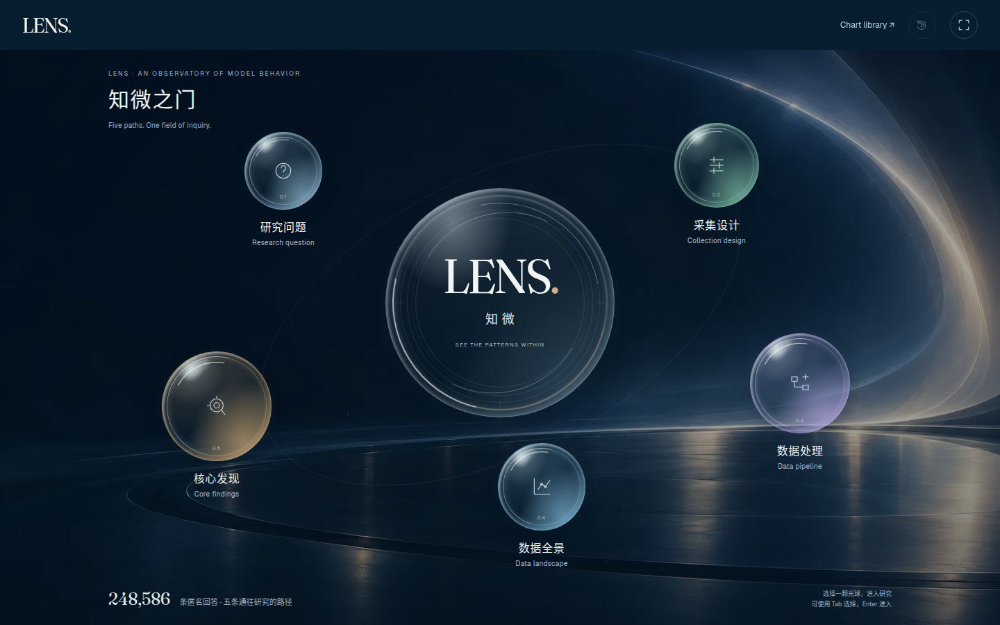

# 知微之门光学优化与全屏研究页 · 检查报告

基线是已发布的 `f44a54f93760a8c9a51c1762ace002834c3d670b`。开始时工作区干净，并建立本地备份分支。此次修改真实源码，经标准构建生成网页；没有只改 dist。

## 实际改动

1. 删除原五章左侧导航的 HTML。五个研究页隐藏顶栏，活动面板从视口 `(0,0)` 铺满宽高；只保留右上角轻量“返回入口”。研究章节标签、条件筛选、图表控制及导出继续保留。
2. 首页采用深蓝光学展台、不同大小和色调的玻璃球体、柔和高光及更疏朗的文字位置。五条路由未改变。手机使用独立的五条玻璃触摸入口，不缩小桌面环绕布局。
3. 实际调用三次 `image_gen.imagegen`：原截图的 A/B 方向、独立无文字背景、实现截图的反馈。采用 B 的材质与构图方向，拒绝生成图中的虚构人物/风景/科研内容。第二轮反馈后上移下方入口，拉开标签与页脚距离。
4. 生成背景源图为1586×992 PNG，格式转换为约31KB WebP。玻璃球体、中央透镜、图标、文字和链接继续使用原生代码，背景失败也不影响路由。
5. 沿用原5.95秒开场及 Motion mini；同一组五个链接与同一个光学 SVG 接续。搬移链接时保留五种材质色调；研究深链接的品牌落点改到可见的返回标记，并匹配落点的文字颜色。手机端仅让玻璃高光缓慢变化，入口行保持稳定。

## 浏览器截图与录屏

| 页面 | 桌面 | 手机 |
| --- | --- | --- |
| 新首页 | [截图](after/gateway-1440.png) | [截图](after/gateway-390.png) |
| 全屏采集设计 | [截图](after/deck-collection-desktop.png) | [截图](after/deck-collection-mobile.png) |
| 全屏核心发现 | [截图](after/story-concise-baseline-desktop.png) | [截图](after/story-concise-baseline-mobile.png) |
| 开场完成 | [截图](after/intro-desktop/1440-complete.png) | [截图](after/intro-mobile/390-complete.png) |

[真实操作录屏](after/gateway-demo-desktop.mp4) 包括完整重播、玻璃球悬停、点击进入研究、返回首页、操作原位置滑块和跳过重播。由 Chromium CDP 直接录制629帧，约16.4秒；没有生成或插入虚构操作画面。[录屏清单](after/video-manifest.json)。

生图稿与真实运行截图分别存放。完整提示、不可变的反馈输入副本、实际输出及 SHA-256 见 [provenance.json](design/provenance.json)。

## 功能与数据验证

本机真实 Chromium 执行的869项检查全部通过。检查覆盖320、390、768、1366、1440五种宽度，并包含减少动态效果与正常动画状态。保存93个状态的桌面/手机截图，共186张；其他专项截图另计。

| 项目 | 通过/检查 | 证据 |
| --- | --- | --- |
| 93状态×5尺寸渲染及资源/错误汇总 | 467/467 | [site-checks.json](after/site-checks.json) |
| 65个原研究状态文字、选择、科学 SVG 对照 | 65/65 | [master-alignment.json](after/master-alignment.json) |
| 原始内容保留与源码/运行文件同步 | 6/6 | [preservation.json](after/preservation.json) |
| 原研究交互、滑块、筛选、导出及可访问性 | 49/49 | [home-interactions.json](after/home-interactions.json) |
| 图表库、代码视图及导出 | 39/39 | [library-interactions.json](after/library-interactions.json) |
| 球体、真实路由、全屏面板、同节点开场衔接 | 123/123 | [gateway-checks.json](after/gateway-checks.json) |
| 背景解码/失败回退、标签间距、材质连续性 | 23/23 | [optical-checks.json](after/optical-checks.json) |
| 真实触摸、重播、窗口变化、延迟及缺失脚本 | 11/11 | [resilience.json](after/resilience.json) |
| 原开场时间轴、字体、键盘、深链接及故障降级 | 86/86 | [intro-checks.json](after/intro-checks.json) |

519个原有数据、图稿、字体、依赖及科学源码文件逐字节保留。65个研究状态与上一已发布版本比较；图表库保留检查同时验证所有13类图表及相关交互。原研究值及结论未修改。

25项专门检查实际测量五个研究页在五种宽度下的位置、宽高和顶栏显示状态。初检发现768px下装饰轨道旋转导致4px横向溢出，已缩短平板轨道并重跑完整检查。两个装饰椭圆以实际可见图元验收，科学图表仍要求完整绘制、正确引用和有限数值。

发布门禁将证据绑定446个当前源文件/输入的 SHA-256，校验三次生图来源、截图、同节点衔接、全屏布局、六组动画测量和八组性能诊断。源码变动后旧证据不能直接用于发布。

## 性能测量

性能测量在其他浏览器检查和录屏结束后独立顺序执行。结果见 [frame-performance.json](after/frame-performance.json) 与 [performance-summary.json](after/performance-summary.json)。八组配对冷加载 Lighthouse 在同一台服务器与 Chromium 上顺序执行，使用 provided throttling，**没有模拟弱网或 CPU 降速**。首页比较使用 `intro=0`。这是本地单次诊断，不是实机手机或统计基准；图表库原有约15.4MB载荷保留。

| 页面/视口 | 修改前性能分 | 修改后性能分 | 修改后 CLS |
| --- | --- | --- | --- |
| 首页 · 手机视口 | 100 | 100 | 0.000068 |
| 首页 · 桌面视口 | 100 | 100 | 0.000101 |
| 图表库 · 手机视口 | 100 | 100 | 0.000022 |
| 图表库 · 桌面视口 | 98 | 98 | 0.000423 |

八组可访问性和最佳实践诊断均为100。未发现配对性能退步；实际可访问性测试的严重/关键项均通过，不能由一个分数推断所有辅助技术均已人工验证。

六组独立实时开场测量未同时截图或录屏，均在约5.96–5.97秒完成、无异常，结束后 RAF 为0、Canvas backing store 为1像素。

| 视口/模拟条件 | 完成时间 | 平均绘制 FPS | p95 JS绘制耗时 |
| --- | --- | --- | --- |
| 1440×900 | 5968ms | 54.2 | 2.5ms |
| 768×1024 | 5966ms | 57.2 | 2.4ms |
| 390×844 | 5964ms | 29.6 | 1.6ms |
| 320×740 | 5960ms | 29.7 | 1.5ms |
| 390×844 · DPR 3 | 5968ms | 30.0 | 1.8ms |
| 390×844 · CPU 4倍减速 | 5971ms | 28.0 | 3.5ms |

原开场小屏绘制预算约30FPS，继续保留。FPS为绘制间隔，JS耗时不包含GPU/合成成本；高DPR与CPU模拟不能证明真实设备表现。新增首页漂移和高光使用 Motion mini/CSS；研究页面、隐藏标签和减少动态效果状态下不继续运行首页背景动画。

## 修改文件

- `app/index.html`：删除全局章节侧栏，增加轻量返回入口与装饰背景。
- `app/gateway.css`：光学材质、桌面层次、手机触摸行和研究页全屏布局。
- `app/src/gateway.js`：移动端高光动画、材质色调随节点保留、响应式落点尺寸。
- `app/src/intro.js`：研究深链接的新落点及文字颜色衔接。
- `app/assets/visual/gateway-atmosphere.webp`：独立生成的装饰背景。
- `app/visual-coverage.json`、`scripts/system/check_visual_coverage.py`：当前证据与发布校验。
- `README.md`、`app/README.md`、`docs/visual-refinement-workflow.md`、`docs/design-sources.md`：入口说明、流程与素材来源。
- `optimization/gateway-polish/`：真实生图记录、截图、录屏与可复现检查脚本。

## 发布与线上复核

本地检查通过后，按会话中已授权的远端预览流程发布。提交、Actions结果和线上逐文件/交互复核结果在实际完成后追加。
