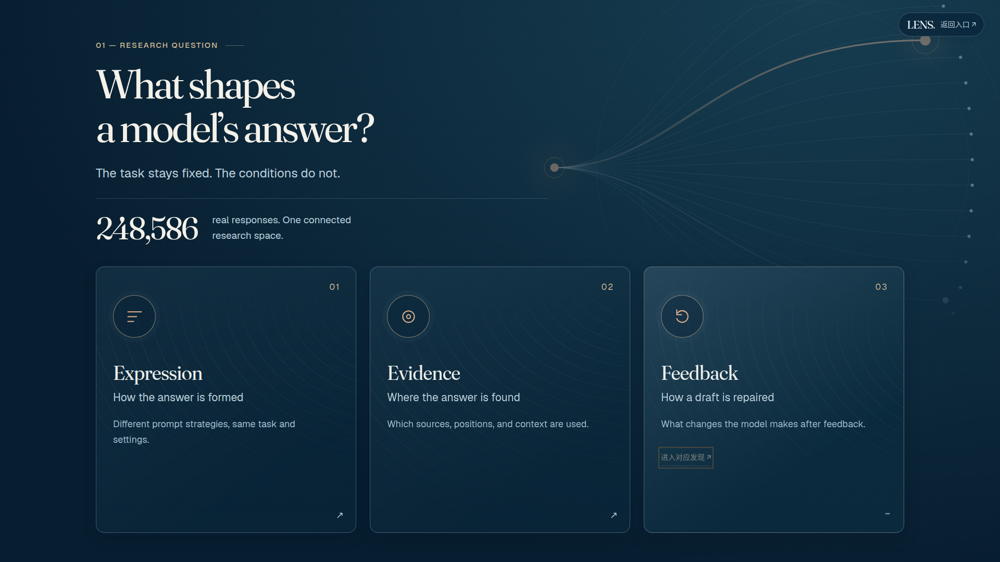
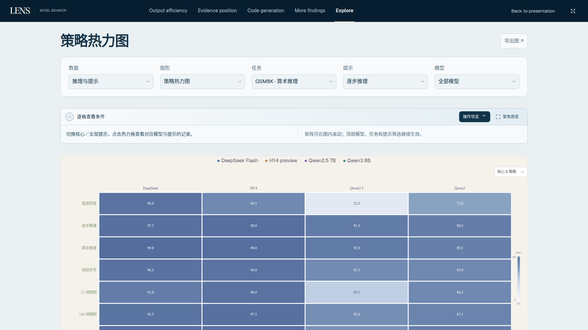

# LENS 逐页交互增强：实际交付与检查记录

日期：2026-11-01。基线为 main / `926c936a3571153eb855571b9ab7768e65c1c1f0`。开始时工作区干净。本轮开发、构建与本地验证已经完成，并已获得用户明确授权发布。实际提交、部署工作流与线上核对结果见本文末的发布记录。

[逐页前后截图对照](gallery.html) · [真实 1080p 交互录屏](after/interaction-demo.mp4) · [完整设计计划](PLAN.md) · [93 状态覆盖表](coverage-table.json) · [检查汇总](after/test-summary.json)

## 实际效果与设计选择

这轮借鉴首页“操作引出内容、运动保持方向感”的思路，延续原有深海蓝、雾蓝灰、冷白与香槟金。根据页面内容选择交互方式，没有把研究页和图表库重新做成球体导航。已有开场、五球交接、研究结论、图表和成熟筛选保持。

新增原生 HTML/CSS/JavaScript 交互层，复用本地 Motion mini 14.9.0。按钮反馈约240ms，图形/面板揭示约480ms，分面错开最多160ms。动效随进入、点击或条件切换发生；不自动播放科研结果，也没有新增长期装饰循环。动画结束恢复原行内样式，快速切换会取消前一轮效果。

| 页面 | 实际新增交互 |
|---|---|
| 知微之门 | 保留原有开场和五球进入；增加可展开的探索指引 |
| Research Question | 三方向卡可选择、展开原研究入口；图标和标题保持对齐，Tab 可进入展开后的链接 |
| Collection Design | 三任务和两专项卡都可展开；共用实验窗口显示各自真实保存规模，并进入原有研究 |
| Data Pipeline | 四节点逐项查看；高亮现有匿名示例中的真实字段，原 JSON 值逐字保持 |
| Data Landscape | 光阑揭示，任务/模型/趋势/矩阵切换反馈；操作导览和图表聚焦 |
| 五项 Core Findings | 简洁配对、中文任务切换、证据位置扫描、修复版本层次、限长分面对照；原滑块、播放、案例、数据表和导出继续使用 |
| Output Efficiency | 配对横向呈现、31 提示扫描；原证据/记录详情滑入 |
| Library Evidence Position | 矩阵逐层呈现、三点剖面横向呈现；原口径与记录入口保留 |
| Code Generation 四视图 | 采样层次、提示矩阵、错误分面、输出开销光阑；原 Pass@k 播放和散点框选联动保持 |
| More Findings 五视图 | 输出上升、提示矩阵、效率光阑、位置扫描、异常分面；各页导览和聚焦可操作 |

图表库全部13类都改动了交互呈现与阅读操作：模型柱图上升、雷达光阑、热力矩阵、气泡聚焦、环形扇面、位置横扫、箱线帘幕、平行坐标横向揭示、分布双面、行为双面联动、时间线横扫、请求树分支进入、流程流向揭示。每类均有独立说明配置与真实浏览器点击检查。代码中的36个交互场景配置复用适合内容的动效原语，不宣称每页都是一套完全独立的动画引擎。

所有含图页面都可以展开“操作导览”和切换“聚焦图表”。聚焦淡化外围说明、突出原图，Esc 或原按钮退出；原筛选仍可使用。核心发现将按钮整合到原图表工具栏，不挤占额外一行。图表库与全貌使用紧凑阅读条，会占用一行纵向空间，但不改变科学图的宽度、内部坐标与字体。详情继续使用原有窗口，图表点击的短暂光学反馈环位于 SVG 外，不进入导出。

## 覆盖与真实检查

生产网站仍只有两个 HTML 入口，93指可恢复的路由/筛选状态，不是93份独立网页。覆盖清单从真实源码枚举：5个研究章节、所有全貌方向/模型/视图、5项发现与36个限长组合、两输出效率视图、两位置视图、4个代码子视图、5个更多发现、13类图形及有意保留的空状态。

- 1366×768、1440×900、1600×900、1920×1080、2560×1440：93状态全量巡检，共467项，全部通过。
- 1440与1920：逐状态新交互、原 SVG/URL 保持、聚焦退出及专属导览；加上卡片、节点、键盘、快速切换、页面隐藏、驱动缺失与窄屏回归，共987项通过。
- 两电脑尺寸各93张修改前、修改后真实截图：186组前后对照，图片、字体均等待加载/解码。
- 版式/标题/编号/ID/首屏图位置对照及15组 WCAG 前后比较，共201项通过。88组核心发现科学图面的位置、宽度与高度完全相同。
- 另外检查320、390、768宽度的7个代表页面的新交互；手机为回归范围，设计重点仍是电脑录制。
- 实际检查图表库筛选、匿名记录、框选、错误联动、分组箱线、热图、多模型、时间线、路径树、代码四视图、采样播放、CSV/SVG 导出和原有首页开场。没有只检查静态截图。

| 检查组 | 项目数 | 通过 |
|---|---:|---:|
| site-checks | 467 | 467 |
| interaction-checks | 987 | 987 |
| layout-review | 201 | 201 |
| preservation | 1110 | 1110 |
| master-alignment | 65 | 65 |
| home-interactions | 49 | 49 |
| library-interactions | 39 | 39 |
| gateway-checks | 123 | 123 |
| optical-checks | 23 | 23 |
| resilience | 11 | 11 |
| intro-checks | 86 | 86 |
| planet-checks | 19 | 19 |
| chart-render-preservation | 184 | 184 |
| export-checks | 31 | 31 |
| nav-access-checks | 25 | 25 |
| early-paint-checks | 12 | 12 |
| desktop-recording-checks | 18 | 18 |
| showcase-checks | 12 | 12 |
| lifecycle-checks | 6 | 6 |
| gallery-checks | 9 | 9 |

共3477项，包含文件字节保护；不能将文件哈希项全部称为浏览器点击测试。完整原始报告都位于`after/`。当次生产源指纹共455个，新发布门禁版本13核对当次源码、完整覆盖、截图、交互及科学保护。没有用旧轮次 PASS 替代本轮结果。

## 科研内容保护

保护清单1,100文件全部逐字节一致，覆盖原 JS、原七份 CSS、字体、依赖、研究数据与图稿。201个大数据文件在当前检出中为原有 Git LFS 指针，检查其指针字节和原对象标识保持；没有下载、重跑或声称重新核对未物化的原始回答全文。实际网页使用的匿名快照、科研图稿及图表实现按真实文件字节校验。

184个科学状态/尺寸组合包含188个实际图形，SVG结构、计算后的绘制样式与标准位置渲染像素完全一致；另外保存了实际可见图形裁切对照。标准位置像素对照消除周围新 UI 带来的页面位移，不会允许图形内部数值、路径、颜色、比例或字体变化。

31项实际CSV/SVG下载与冻结基线对照通过。CSV比较实际字节；SVG只规范本地生成的ID，保留路径、数值、几何、文字与样式。原异常、缺失、置信区间、评分及数据来源没有改变。

九位置专项实验与图表库三位置实验继续分开；多轮反馈修复与五次独立采样继续分开。新实验窗口直接读取原 narrative 数据的保存规模，不编造筛选统计或新结论。

## 发现并修正的问题

1. 首轮实际发现：新导览横条将核心发现图下推74px，1366首屏门禁失败。改为原工具栏内的紧凑操作；保留原断言，最终全量复测通过，88组核心发现图面位置/尺寸均与原版相同。
2. 方向卡展开后图标高度不齐，改为统一顶部对齐；选中态保持标题对齐，仅悬停保留3px微动反馈。
3. 特殊 Unicode 光学符号可能显示方框，改用纯 CSS 透镜与焦点角标。
4. 动画结束可能留下 Motion 写入的变换属性；新增逐属性恢复与快速点击取消，验证完成后原行内布局属性恢复。
5. 卡片展开后链接的 Tab 顺序不自然，调整按钮与展开内容的 DOM 顺序并真实验证。
6. 测试脚本曾把真实空状态误当成必须绘制 SVG 的页面，现改为等待页面实际空状态；空集合仍由全站巡检严格识别，不补造图形。
7. 原饼图尚未完成原生绘制时就比较 SVG 会产生时序差异；现在等待真实绘制结束和鼠标离开，再比较原 SVG。原科学绘制不改。
8. 漂浮光球的测试曾在鼠标尚未进入时等待“永远静止”，造成超时；改为按实际使用方式先移动鼠标、触发原有暂停漂移，再真实点击，没有强制点击或修改首页动画。
9. 原文对照现在仅剔除明确标记的新 UI 节点，原说明、原内容、科学 SVG 全部继续比较；原先排除的方向补充说明也纳入本轮原文对照。

首轮失败和实拍保存在`iterations/`，未删除失败记录。更新检查是为了覆盖新界面和真实状态，不修改科研数据或放宽原首屏断言。

## 性能与录屏

新增运行时代码为27,851字节 JS和10,473字节 CSS；复用原本地8,771字节 Motion mini，不引入新框架、后端或在线API。

八次同机冷加载配对 Lighthouse 使用`provided`，无模拟弱网或CPU减速；测试时其他本轮浏览器任务已经结束。

| 页面／电脑尺寸 | 性能：修改前 → 修改后 |
|---|---:|
| home / desktop | 100 → 100 |
| home / fullhd | 100 → 100 |
| library / desktop | 98 → 98 |
| library / fullhd | 98 → 98 |

各次 CLS 均低于0.02。它们是单次本地诊断，不能把小幅分数波动当作提速结论。

六次原开场完整播放均正常结束，随后RAF为0、Canvas缩至1像素。本机无头Chromium帧间隔诊断：1440×900：57.1fps；1920×1080：45.7fps；2560×1440：27.1fps；1366×768：58.0fps；1920×1080 / DPR2：49.3fps；1920×1080 / CPU×4：30.6fps。原开场源码未改；这些测量包含本机软件渲染环境，不能保证录屏电脑或所有尺寸均达到60fps。

录屏为真实 Chromium CDP 捕获，1920×1080、H.264、约62秒、1470个真实捕获帧，文件约7.6MB，44个实际操作步骤。没有生成图插帧，也没有把录屏作为网页的播放素材；捕获帧数不作为性能帧率证明。

## 修改文件

- 新增：`app/src/interaction.js`、`app/interaction.css`。
- 接入：`app/index.html`、`app/explore.html`。
- 构建：`scripts/system/build_web_app.py`，负责复制和内容版本。
- 门禁：`scripts/system/check_visual_coverage.py`、新增`check_interaction_coverage.py`、`app/visual-coverage.json`。
- 说明：根`README.md`、`docs/interaction-and-tools.md`、`docs/visual-refinement-workflow.md`。
- 本目录：计划、覆盖表、冻结构建清单、保护清单、前后截图、原始测试报告、迭代记录、录屏和复现脚本。

没有改动任何原图表组件、原科研数据文件或原有CSS源码，没有只编辑dist。

## 预览、复现及限制

当前服务器本地预览：`http://127.0.0.1:8838/?intro=0`；该地址是服务器回环地址，远程电脑需使用已有端口转发。亦可在项目中运行`python3 app/launch.py --port 8770`。直接看交互录屏和本目录`gallery.html`无需发布到GitHub Pages。

完整复现：先在8838提供当前`app/dist`、8849提供`.git/interaction-review/baseline-dist`，再运行`python3 optimization/interaction-design-20261101/scripts/run-review.py`。冻结构建的229文件清单已保存且与原入口和样式的`git show 926c936:app/...`内容独立核对。若换机器，应在独立926c936检出中标准构建，按`frozen-build.json`验证后作为基线，不能用当前版本冒充修改前。

已知限制：扩展的 WCAG 2.1 A 检查发现原有首页5个光球及原返回/品牌入口存在`label-content-name-mismatch`（可访问名称未完整覆盖可见文案）。在修改前后完全相同，本轮新控件没有增加此问题；原有回归检查采用的标签集不包含这一规则。不能因此称全站通过了完整WCAG认证。原科学文字、图例与数据语义保持，本轮重点是电脑端交互。

发布由用户在本地验收后明确授权；实际部署与线上核对见末节。

## 参考与实现边界

参考[Motion](https://github.com/motiondivision/motion)和[transition.css](https://github.com/argyleink/transition.css)的方向、节奏及可中断思路；[View Transition API](https://developer.mozilla.org/en-US/docs/Web/API/View_Transition_API)用于理解跨状态过渡。本轮采用已有 Motion mini 与局部 Web Animations，不复制其整套皮肤，也不迁移框架。视觉直接用原生代码实现，没有新增生图调用或运行时位图；保留先前实际生成并验收的首页素材。

